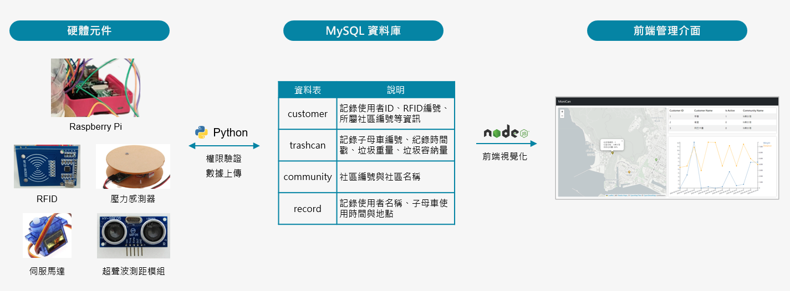
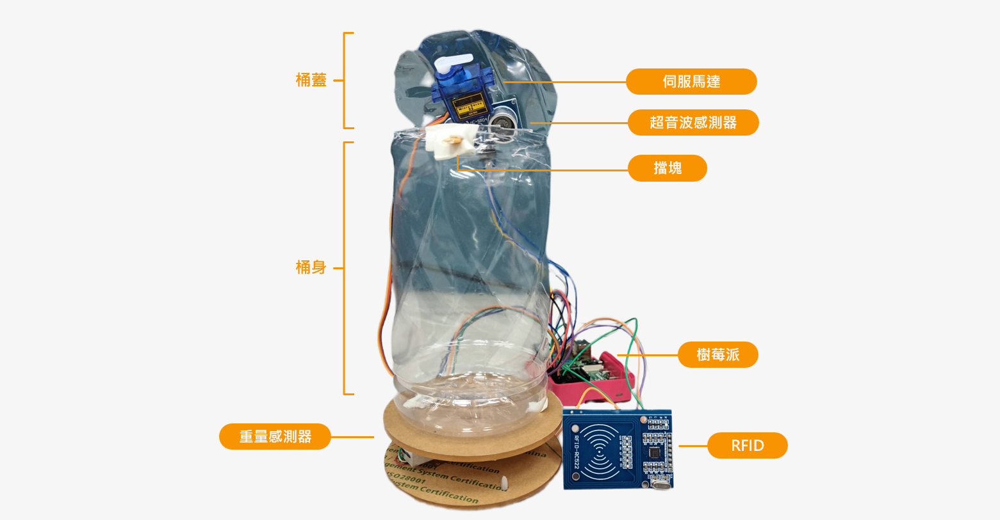
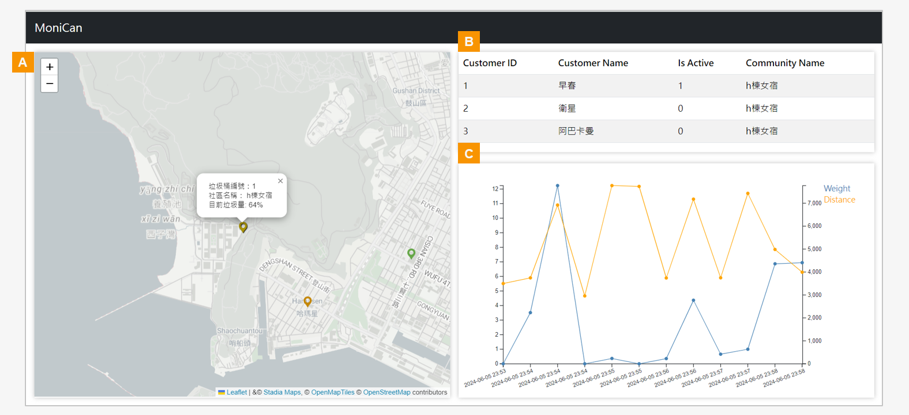

# MoniCan - 智慧子母車物聯網系統

> 本專案為 112 學年度物聯網課程之個人期末專案。
<br>

## 🗑️ MoniCan 系統簡介
本專案發想來自於社區子母車的兩個痛點：被非社區住戶丟棄垃圾影響住戶權益，以及收運不及導致垃圾爆滿。為此，本專案開發 **MoniCan 智慧子母車雛型系統**，其由**硬體元件**、**資料庫**與**前端管理介面**三部分組成，透過硬體元件收集子母車容納與使用狀況，以資料庫記錄使用者權限與元件數據，並於前端介面視覺化資料以便進行後續收運排程管理。



<p align="left" style="font-size: 13px; margin-top: -8px;" id="glyph">
  <b>圖 1</b>： MoniCan 透過樹莓派 (Raspberry Pi) 控制硬體，以 Python 進行 MySQL 資料庫使用者權限驗證與物聯網數據上傳。同時，前端介面使用 Node.js 撰寫 API 抓取資料庫資訊，並進行視覺化呈現。
</p>


### 硬體元件
MoniCan 使用寶特瓶與下列元件製作簡易雛型系統（圖2），各元件說明如下：
- **樹莓派**：系統的控制核心，負責統整各感測器數據、執行驗證邏輯，並控制馬達動作與上傳數據。
- **RFID 模組**：以卡片感應驗證使用者身份與權限管理，防止外人隨意丟棄。
- **伺服馬達 — 擋塊**：裝於上蓋，配合 RFID 驗證，以旋轉角度控制垃圾桶上鎖與解鎖。
- **超音波感測器**：裝於上蓋，偵測垃圾堆疊高度，監控空間容量。
- **重量感測器**：置於底部，即時量測總重，作為滿載程度的輔助判斷依據。

<div style="display: flex; justify-content: center;">
  
</div>
<br>
<p align="left" style="font-size: 13px; margin-top: -8px;" id="glyph">
  <b>圖 2</b>： 寶特瓶製作之 MoniCan 雛型系統，硬體邏輯與資料庫連接均由樹莓派控制執行。超音波感測器裝於上蓋，測量垃圾距離桶頂高度；重量感測器則置於桶底，以測量總重量。伺服馬達位於上蓋，配合裝於桶身的垂直擋塊形成上鎖機關，其開關權限由 RFID 模組感應判斷。
</p>

### 前端介面
MoniCan 介面設計旨在支援子母車收運公司人員即時掌握垃圾量，方便管理與評估清運需求。系統介面分為三個區塊：

- **地圖**：顯示子母車站點位置與目前垃圾累積數量，透過綠至棕色的漸層色彩呈現裝載程度。
- **權限資訊**：顯示使用者資訊與帳號權限。
- **收運數據**：即時呈現垃圾總重量與距桶頂高度，方便評估清運需求。

本雛型系統主要實作物聯網硬體感測、資料庫儲存至網頁前端的資料串接流程，完成感測數據的傳輸、儲存與即時呈現。未來若進一步應用於實際營運場景，可考慮延伸權限管理及歷史數據分析等功能，作為清運路徑規劃與人員排班的參考。


<p align="left" style="font-size: 13px; margin-top: -8px;" id="glyph">
  <b>圖 3</b>： MoniCan 系統介面。（A）地圖介面，標示各地子母車即時垃圾量；（B）使用者權限資訊；（C）子母車各時間點垃圾重量與距桶頂高度之折線圖。
</p>

## 💻 開發工具

- **硬體控制**：Python
- **後端 & 資料庫**：Python、Node.js、PHP、MySQL
- **前端介面**：Vue.js、BootstrapVue、d3.js

## 📂 重要檔案指南

```text
├── index.js                 # 後端 Express 伺服器與 API 路由設定
├── new.php                  # 資料庫連線，生成更多資料模擬多資料情境
├── pi/                      # 樹莓派端程式
│   └── merge_code.py        # 各感測器與控制邏輯，並將數據上傳資料庫
└── trash_proj/              # 前端視覺化專案 (Vue.js)
    ├── assets/              # 地標與垃圾桶圖示
    ├── components/          # UI 元件
    │   └── Map.vue          # 地圖介面
    └── src/                 # 前端核心原始碼
        ├── App.vue          # 根組件，含svg折線圖繪製
        ├── FetchService.js  # API 抓取資料
        └── main.js          # 前端進入點
```